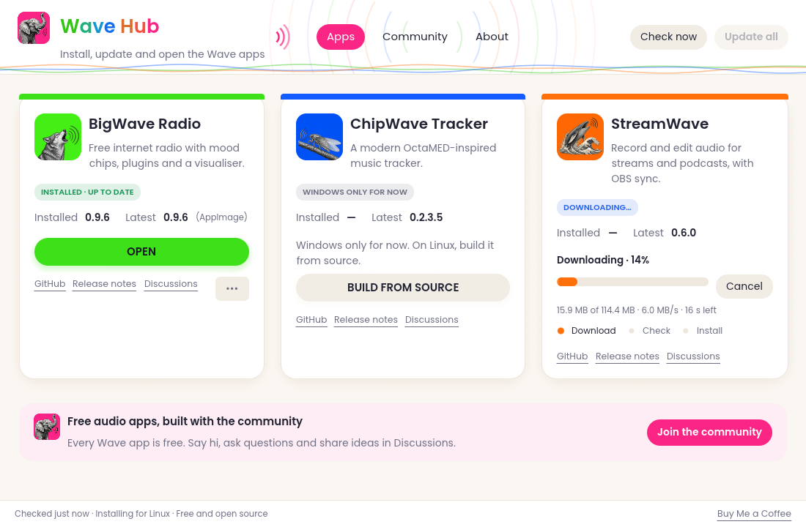
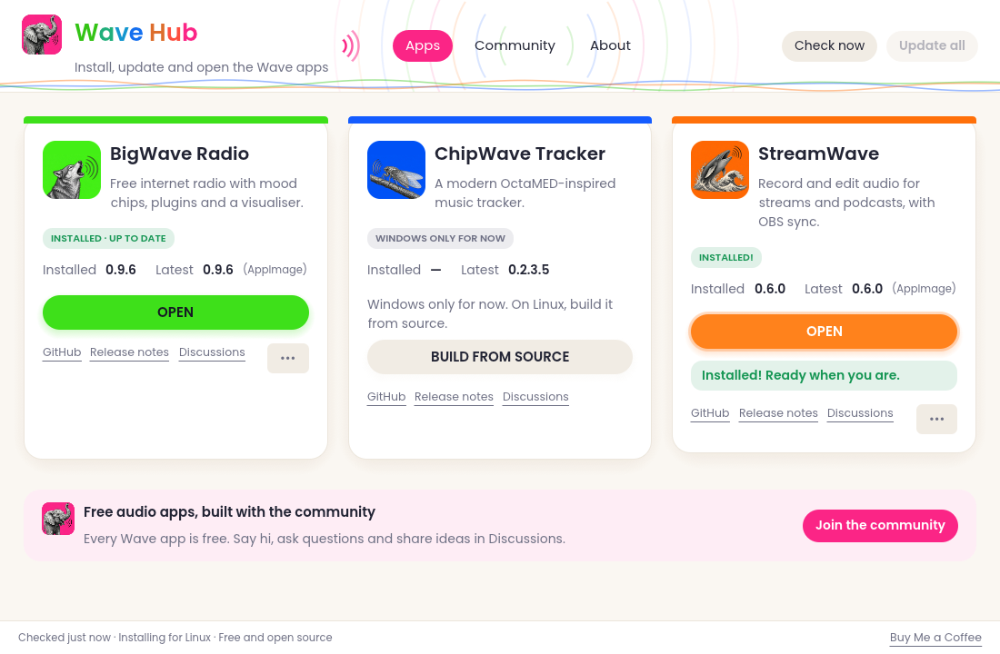
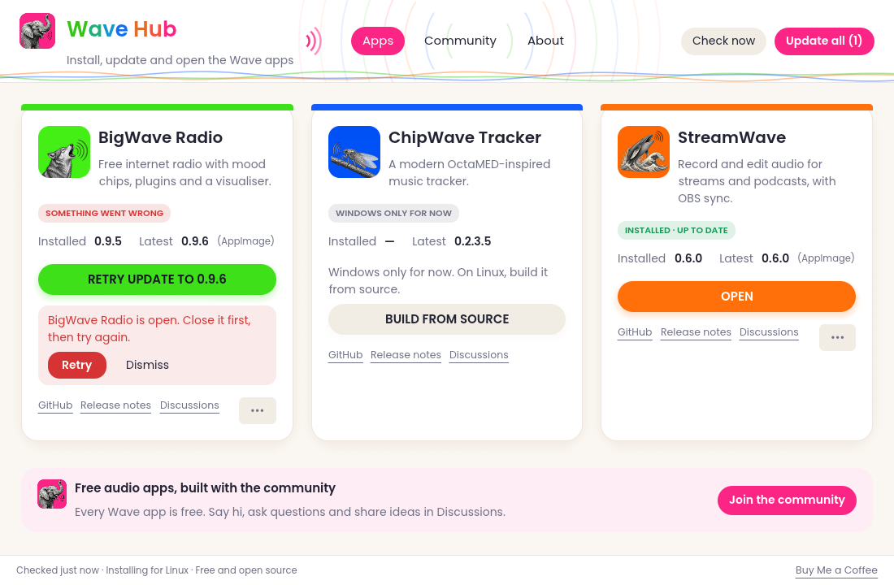
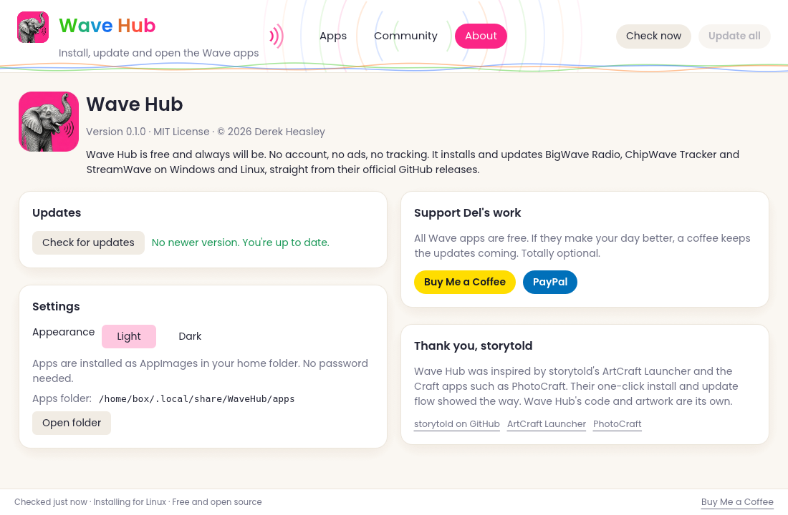

<p align="center">
  
</p>

<h1 align="center">Wave Hub</h1>

<p align="center">
  <b>Free for Windows and Linux.</b><br>
  One place to install, update and open the Wave apps: BigWave Radio, ChipWave Tracker and StreamWave.
</p>

<p align="center">
  <a href="https://github.com/postmanpat-303/WaveHub/releases"><b>⬇ Download Wave Hub</b></a> ·
  <a href="https://github.com/postmanpat-303/WaveHub/discussions">Discussions</a> ·
  <a href="https://buymeacoffee.com/postmanpat">Buy Me a Coffee</a>
</p>

<p align="center">
  
</p>

Wave Hub is a small, friendly app that looks after the Wave family for you. Click **Install**
and it downloads the right version for your computer, checks it, and sets it up. When a new
version comes out, click **Update**. That's it. No account, no ads, no tracking.

| App | What it is |
| --- | --- |
| 🐺 [BigWave Radio](https://github.com/postmanpat-303/BigWaveRadio) | Free internet radio with mood chips, plugins and a visualiser |
| 🦗 [ChipWave Tracker](https://github.com/postmanpat-303/ChipWaveTracker) | A modern OctaMED-inspired music tracker |
| 🐋 [StreamWave](https://github.com/postmanpat-303/StreamWave) | Record and edit audio for streams and podcasts, with OBS sync |

## What it does

- **One click** to install, update or open each app. No dialogs.
- **One smooth progress bar** through each stage (download, check, install), showing the size,
  speed and time left. When it's done, the button turns into **Open**.
- **Update all** updates every app that has a new version, one after another.
- **Checks every download** against the app's published `SHA256SUMS.txt` before installing it.
- **Never replaces an app while it's open.** Close it and click **Retry**.
- **No admin password needed:** apps go into your own user folder.
  - Windows: `%LOCALAPPDATA%\WaveHub\apps`, using each app's portable version.
    StreamWave only comes with an installer, so Wave Hub runs it quietly in the background.
  - Linux: `~/.local/share/WaveHub/apps`, using each app's AppImage.
- ChipWave Tracker has no Linux download yet, so on Linux its card says "Windows only for now"
  and links to the build-from-source instructions.
- **Light and dark themes** (light by default) in **About → Settings**.
- A **Community** page with each app's Discussions, and **Check for updates** for Wave Hub itself.

<p align="center">
  
  
</p>
<p align="center">
  
  
</p>

## Download and install

Get the newest version from the **[releases page](https://github.com/postmanpat-303/WaveHub/releases)**.

**Windows (10 and 11)**
1. Download `WaveHub.exe`.
2. Double-click it. Wave Hub is a single program; there's nothing to install.
   Windows may say it "protected your PC" because the file is new and not code-signed yet.
   Click **More info → Run anyway**.

**Linux (x86_64)**
1. Download `WaveHub-linux-x86_64`.
2. Make it runnable and start it:
   ```sh
   chmod +x WaveHub-linux-x86_64
   ./WaveHub-linux-x86_64
   ```

To check your download, compare it with `SHA256SUMS.txt` from the same release
(`sha256sum -c SHA256SUMS.txt --ignore-missing` on Linux, `certutil -hashfile WaveHub.exe SHA256` on Windows).

> [!NOTE]
> This is the first release and it's marked **pre-release**. It has been tested on Linux and
> under Wine. If you try it on Windows, especially installing StreamWave, please say how it went in
> [Discussions](https://github.com/postmanpat-303/WaveHub/discussions) or
> [open an issue](https://github.com/postmanpat-303/WaveHub/issues).

## Adding an app

The app list lives in [`apps.json`](apps.json). Each app has its GitHub repo and the names of its
release files, with `{version}` where the version number goes, for example
`BigWaveRadio-{version}-windows-x64.zip`. To try a change without rebuilding, copy `apps.json` into
Wave Hub's data folder (`%LOCALAPPDATA%\WaveHub` or `~/.local/share/WaveHub`).

Wave Hub finds new versions through `https://github.com/<repo>/releases/latest`, which doesn't use
GitHub's API, so there's no hourly limit to run into.

## Building from source

You need Rust ([rustup.rs](https://rustup.rs)).

```sh
cargo run --release          # build and run on this computer
./scripts/build-all.sh       # Linux + Windows programs and SHA256SUMS.txt into dist/v<version>/
```

The Windows build on Linux also needs `rustup target add x86_64-pc-windows-gnu` and
`sudo apt install mingw-w64`. Release files must keep the names `WaveHub.exe` and
`WaveHub-linux-x86_64`, because Wave Hub's own update check links straight to them.

## 💛 Thank you, storytold

Wave Hub was inspired by [storytold](https://github.com/storytold)'s
[ArtCraft Launcher](https://github.com/storytold/craft-launcher) and their Craft apps such as
[PhotoCraft](https://github.com/storytold/photocraft). Their one-click install and update flow
showed the way. Wave Hub's code and artwork are its own; none of ArtCraft's code, names, logos or
icons are used.

## ☕ Support

Wave Hub and all the Wave apps are free and always will be. If they make your day a little
better, you can help keep them going:

<p>
  <a href="https://buymeacoffee.com/postmanpat"></a>
  <a href="https://paypal.me/derekh100"></a>
</p>

## Licence

Wave Hub is released under the [MIT License](LICENSE). © 2026 Derek Heasley.

The Poppins font in `assets/fonts/` is by the Poppins Project Authors and is used under the
SIL Open Font License 1.1 (see [`assets/fonts/OFL-Poppins.txt`](assets/fonts/OFL-Poppins.txt)).
