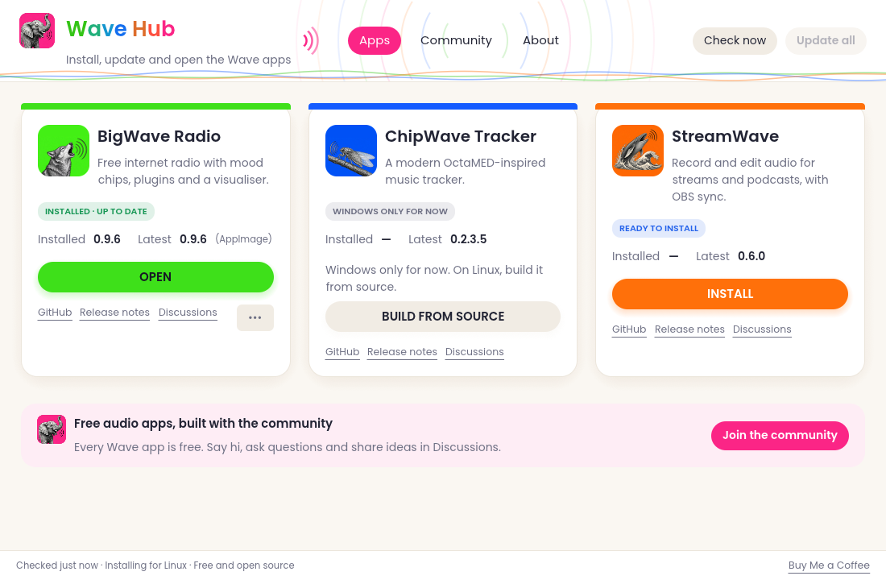

# Wave Hub

One place to install, update and open the Wave apps:

- **BigWave Radio**: free internet radio with mood chips, plugins and a visualiser
- **ChipWave Tracker**: a modern OctaMED-inspired music tracker
- **StreamWave**: record and edit audio for streams and podcasts

Wave Hub is free, for Windows and Linux. No account, no ads, no tracking.



## What it does

- Shows a card for each app with its installed version and the newest version on GitHub.
- One click per app: **Install**, **Update** or **Open**. No dialogs. One smooth progress bar
  shows each stage (Download, Check, Install) with size, speed and time left, and the button
  turns into **Open** with a short "Installed!" message when it's done.
- Problems show on the card itself, with **Retry**. **Cancel** stops a download and tidies up.
- **Update all** updates every app that has a new version.
- Checks every download against the app's published `SHA256SUMS.txt` before installing it.
- Never replaces an app while it's open. Close it first and Wave Hub will update it.
- Installs into your own user folder, so no admin password is needed:
  - Windows: `%LOCALAPPDATA%\WaveHub\apps` (the portable version of each app).
    You can switch to each app's official installer in **About → Settings**.
    StreamWave only ships an installer, so Wave Hub runs it silently (`/S`) and finds the
    program afterwards (in its usual folder, or from the Windows uninstall entry).
  - Linux: `~/.local/share/WaveHub/apps` (the AppImage of each app).
- ChipWave Tracker has no Linux download yet, so on Linux its card says
  "Windows only for now" and links to the build-from-source instructions.
- Bright, friendly **light theme** by default, with a **dark theme** in **About → Settings →
  Appearance** (remembered in `settings.json`).
- **Community** page with links to each app's Discussions, and an **About** page with
  "Check for updates" for Wave Hub itself.

Wave Hub remembers what it installed in `installed.json` in the same folder.

## Adding an app

The app list lives in [`apps.json`](apps.json). Each app has its GitHub repo and the names of
its release files, with `{version}` where the version number goes, for example
`BigWaveRadio-{version}-windows-x64.zip`. Add an entry, add its icon in `assets/icons/` and
`src/app.rs` (`icon_bytes`), and rebuild.

To try a change without rebuilding, copy `apps.json` into Wave Hub's data folder
(`%LOCALAPPDATA%\WaveHub` or `~/.local/share/WaveHub`); it's used instead of the built-in list.

## How it finds new versions

Wave Hub asks `https://github.com/<repo>/releases/latest`, which redirects to the newest release's
tag. That doesn't use GitHub's API, so there's no hourly limit to run into. Download links are
then `https://github.com/<repo>/releases/download/<tag>/<file>`.

## Building

Development builds (`cargo run`) can slow downloads down to watch the progress bar:
`WAVEHUB_SLOW_KBPS=2000 cargo run`. Release builds ignore this.


You need Rust (via [rustup](https://rustup.rs)).

```sh
cargo run --release            # build and run on this computer
./scripts/build-all.sh         # Linux + Windows programs into dist/
```

For the Windows build on Linux you also need `rustup target add x86_64-pc-windows-gnu` and
the mingw-w64 cross compiler (`sudo apt install mingw-w64`). The Windows program has the Wave Hub
elephant icon built in.

## Credits

The Poppins font (`assets/fonts/`) is by the Poppins Project Authors, under the SIL Open Font
License 1.1 (see `assets/fonts/OFL-Poppins.txt`).

The idea and layout are inspired by [ArtCraft Launcher](https://github.com/storytold/craft-launcher)
(MIT / Apache-2.0). Wave Hub's code is written from scratch and uses none of ArtCraft's code,
names, logos or icons.

## Licence

MIT. See [LICENSE](LICENSE). © 2026 Derek Heasley.
